# Moneta · Full-Stack Banking Platform

A full-stack banking simulation with React, FastAPI and PostgreSQL, built to demonstrate atomic transfers, concurrent-request safety, secure session handling and testable engineering decisions.

**Simulation only.** Users, account numbers and VND balances are fictional. Moneta does not connect to banks, move real money or collect real customer information.

**V2 increment · M0–M5:** account lifecycle and roles, saved recipients, server-verified transfer review, advanced history, reconciled CSV statements, scheduled transfers, a leased PostgreSQL worker and a deduplicated in-app inbox. **Overall V2 remains in progress:** analytics/budgets, security settings and the full operations center are pending. [Current feature matrix](docs/v2/FEATURE_MATRIX.md) · [Implementation status](docs/v2/IMPLEMENTATION_STATUS.md) · [Actual verification](docs/v2/TEST_REPORT.md).

V1 baseline (11 November 2026): 70 backend / 59 frontend / five E2E, 96% application line coverage. **Latest local V2 checks (12 November 2026): 134 backend, 70 frontend, ten Chromium E2E and 36 parity cases passed; backend application line coverage 95%.** Integrated CI and final follow-up executions are distinguished in the verification report. Remote GitHub Actions has not been run during this upgrade.

## Product preview

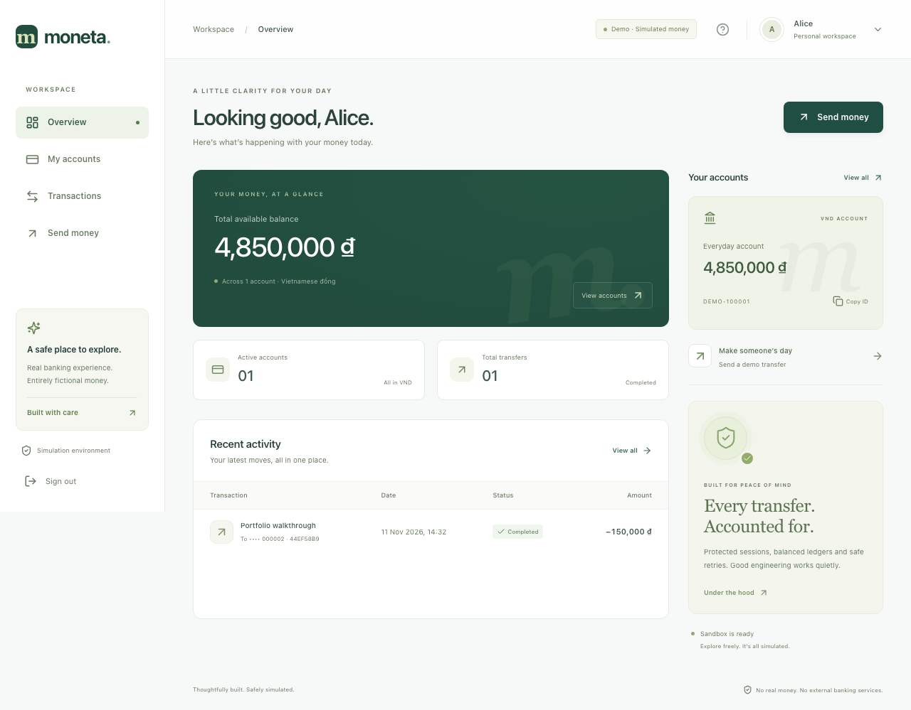

*The dashboard after a real 150,000 VND transfer on an isolated, freshly seeded test database. Balances and transaction history come from the API.*

<details>
<summary><strong>View sign-in, transfer review, receipt and mobile screenshots</strong></summary>

| Sign in | Review before sending |
|---|---|
| [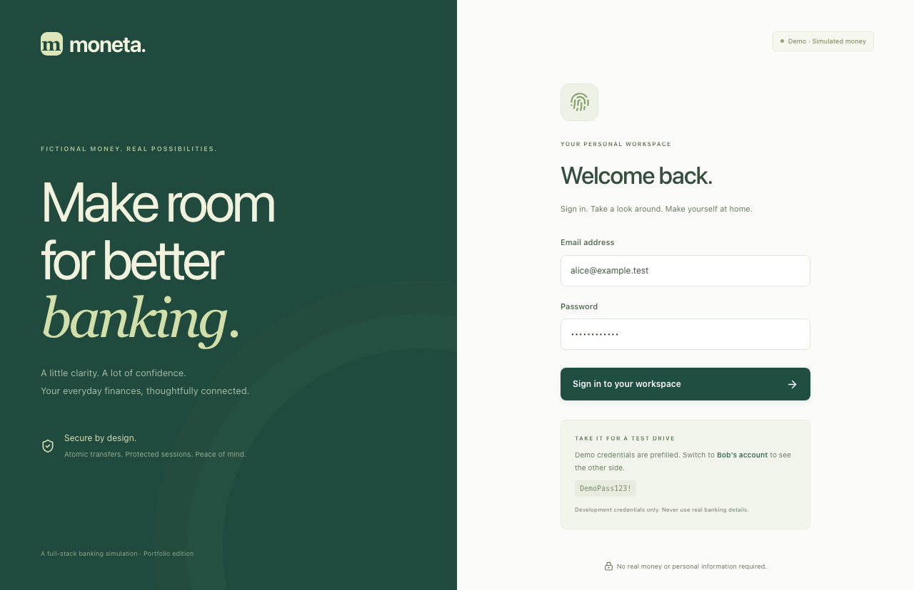](docs/screenshots/login.png) | [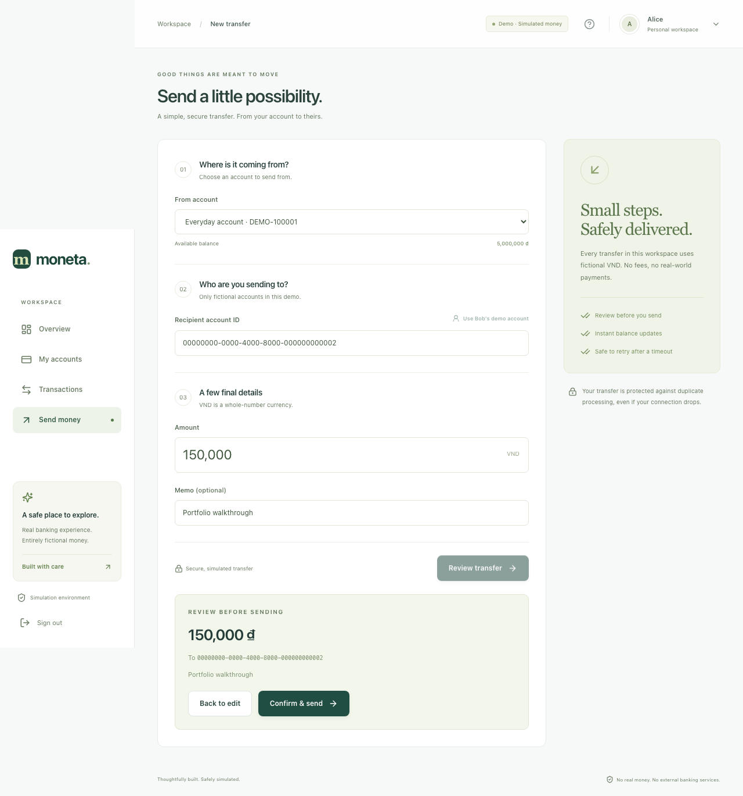](docs/screenshots/transfer.png) |

| Transfer receipt | Responsive mobile workspace |
|---|---|
| [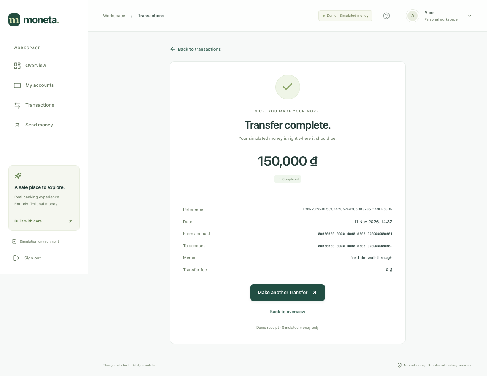](docs/screenshots/receipt.png) | <a href="docs/screenshots/mobile.png">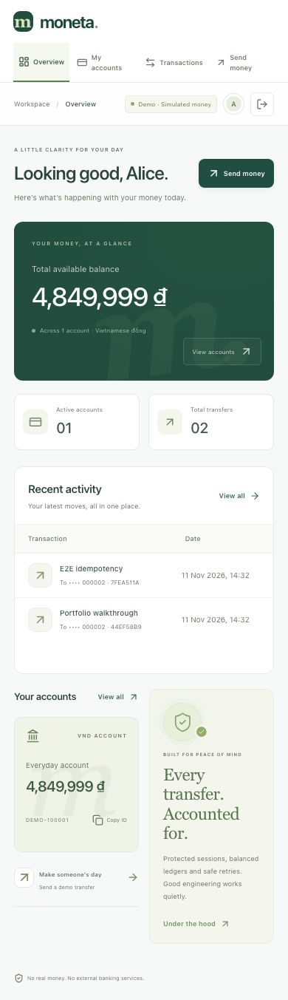</a> |

Screenshots were captured from the running application. The mobile image includes an additional 1 VND API test, so its balance differs from the desktop walkthrough by 1 VND. Dates and references are generated at runtime.

</details>

<details>
<summary><strong>View dropdown interaction details</strong></summary>

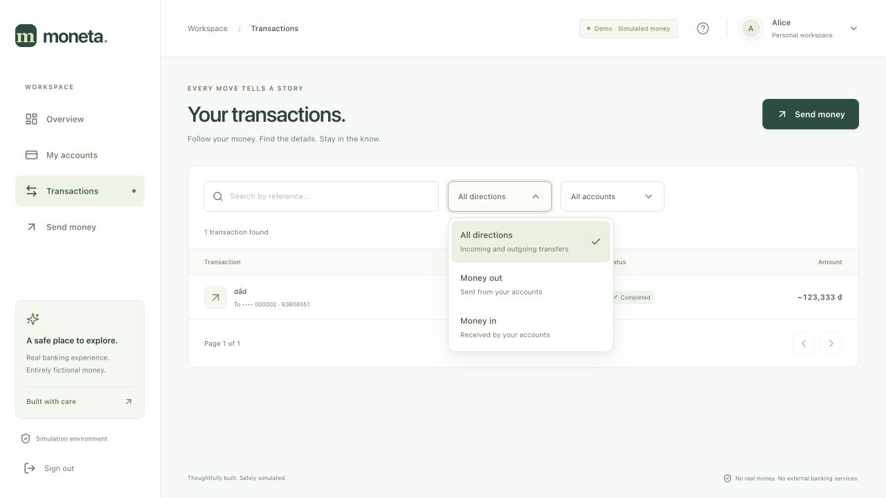

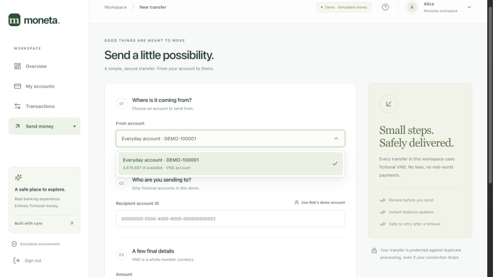

The shared dropdown supports arrow keys, Home/End, Enter/Space, Escape, Tab and typeahead. Menus render outside clipping containers, reposition on scroll/resize and fit the viewport. The source selector stays connected to form validation and becomes disabled during transfer review/submission. These two captures show a separate interactive demo session.

</details>

## V2 preview and review path

| Reconciled statements | Durable schedule execution |
|---|---|
| [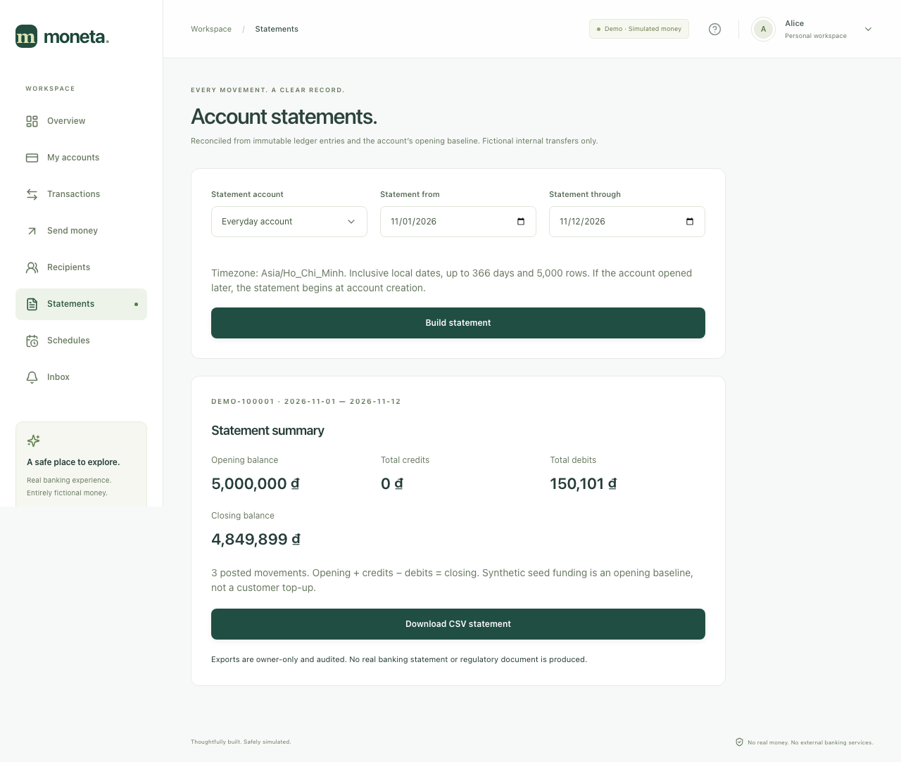](docs/screenshots/v2-statements.png) | [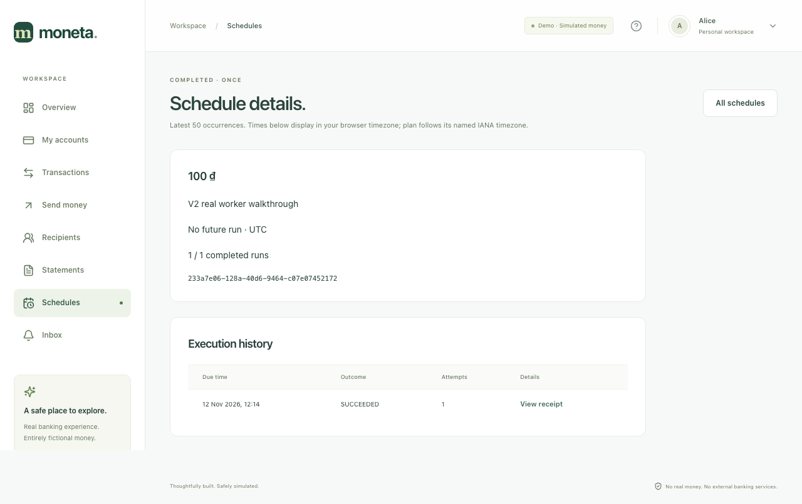](docs/screenshots/v2-schedule.png) |

| Saved recipients | In-app notifications |
|---|---|
| [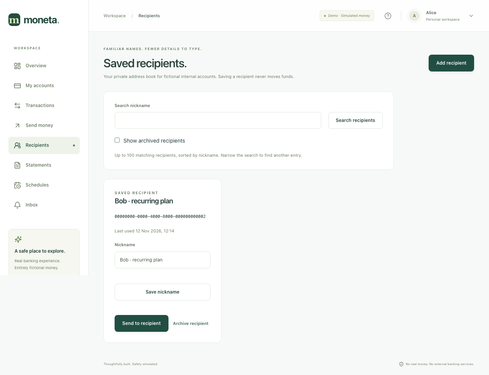](docs/screenshots/v2-beneficiaries.png) | [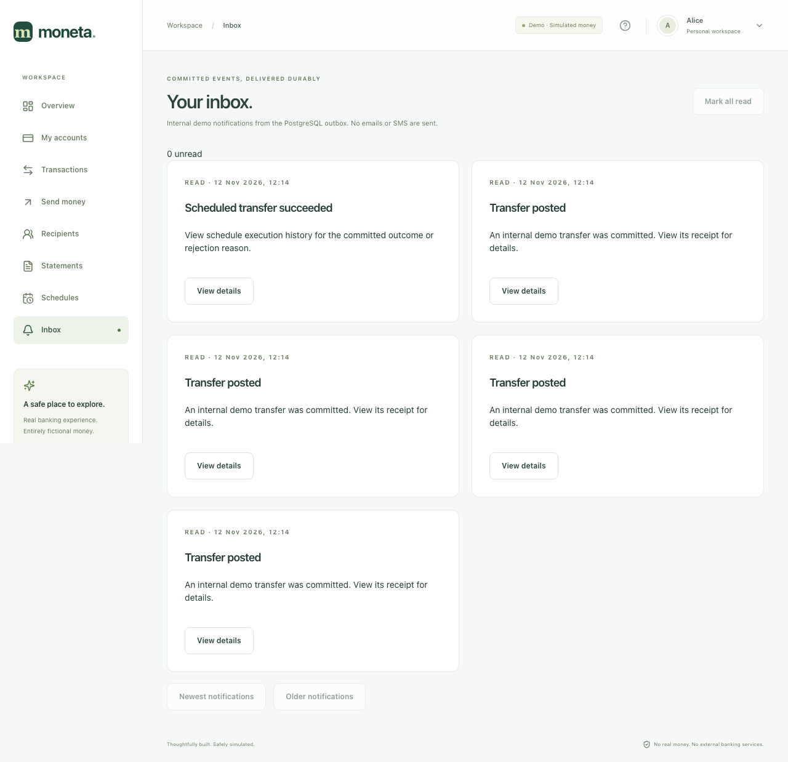](docs/screenshots/v2-inbox.png) |

V2 captures come from the isolated running API, worker and PostgreSQL E2E stack. Earlier dashboard/mobile images above document the V1 baseline. [Printable V2 receipt](docs/screenshots/v2-receipt.png).

Review [architecture](docs/v2/ARCHITECTURE.md), [API contracts](docs/v2/API_CONTRACTS.md), [threat model](docs/v2/SECURITY_THREAT_MODEL.md), [incident reproductions](docs/v2/INCIDENT_RUNBOOKS.md), [metrics and unmeasured targets](docs/v2/SLO_AND_METRICS.md), and [upgrade/backup rehearsal](docs/v2/DEPLOYMENT_CHECKLIST.md). Decisions explain [snapshot arithmetic](docs/v2/ADR/002-statement-snapshots.md) and [fenced worker claims](docs/v2/ADR/003-scheduled-posting-and-delivery.md).

## What to review first

The project concentrates on the boundaries where a financial-style application can fail: a retry becomes a second debit, two requests spend the same balance, a rotated credential remains usable, or a valid user accesses someone else's resource.

| Review question | Implementation and evidence |
|---|---|
| Can the same request debit twice? | [Transfer service](backend/app/transfers.py): unique key claim, canonical input hash and exact saved response. See `test_success_and_exact_replay` and `test_twenty_four_parallel_same_key` in [backend tests](backend/tests/test_platform.py). |
| Can concurrent transfers overdraw an account? | Both account rows are locked in UUID order before balance checks. Tests cover distinct-key spending and opposite-direction transfers. |
| What happens if a ledger write fails? | Claim, balances, transfer, ledger and response share one transaction. The injected-failure test checks complete rollback and successful retry. |
| Does authentication include object authorization? | [Ownership-scoped queries](backend/app/repositories.py), source-owner checks and Alice/Bob/Carol isolation tests. |
| Does the browser handle failures safely? | [Typed HTTP boundary](frontend/src/lib/api.ts), [transfer form](frontend/src/TransferForm.tsx), coordinated refresh and same-key timeout retry tests. |
| Can translated business logic preserve behavior? | [Python/TypeScript migration](docs/migration-parity.md): 36 shared expected results and byte-for-byte canonical JSON comparison. |
| Can worker restarts repeat a payment? | [Worker](backend/app/worker.py): stable occurrence identity, lease-token fencing and atomic posting/outcome; [process death and redelivery tests](backend/tests/test_scheduling.py). |
| Can a statement mix balances from different commits? | [Reporting](backend/app/reporting.py): REPEATABLE READ, immutable funding baseline and exact aggregate strings; [coordinated concurrent-commit test](backend/tests/test_reporting.py). |
| Can another developer reproduce the result? | Compose, Alembic, repeatable seeds, isolated test databases, Make targets and [CI workflow](.github/workflows/ci.yml). |

For a short review, run the demo below, read the transfer service, then inspect the concurrency and rollback tests. A [seven-minute walkthrough](docs/demo-script.md) connects the UI behavior to the implementation.

## Contents

- [Run locally](#run-locally)
- [Demo accounts and walkthrough](#demo-accounts-and-walkthrough)
- [Features and application routes](#features-and-application-routes)
- [Technology stack](#technology-stack)
- [Architecture](#architecture)
- [Transfer correctness and idempotency](#transfer-correctness-and-idempotency)
- [Data model and monetary rules](#data-model-and-monetary-rules)
- [Authentication and security](#authentication-and-security)
- [API reference and replay exercise](#api-reference-and-replay-exercise)
- [Testing and verification](#testing-and-verification)
- [GitHub Actions](#github-actions)
- [Configuration and development](#configuration-and-development)
- [Troubleshooting](#troubleshooting)
- [Repository map and engineering notes](#repository-map-and-engineering-notes)
- [Scope, tradeoffs and next steps](#scope-tradeoffs-and-next-steps)
- [Publishing this portfolio](#publishing-this-portfolio)

## Run locally

### Requirements

| Tool | Needed for |
|---|---|
| Docker Desktop, or Docker Engine with Linux containers | Running the application and PostgreSQL-backed checks |
| Docker Compose **2.24.4+** | Service orchestration; the isolated E2E configuration uses `!override` |
| Git | Cloning and version control |
| Node **22.18+** or Node 24 LTS | Frontend development, Vitest, Playwright and the TypeScript parity runner |
| Make | Convenience targets; the initial application start also works directly with Compose |

Node and a host Python installation are **not required to run the containerized app**. Docker builds the frontend and runs Python inside the backend image. Native ARM64 builds and browser journeys were verified on Apple Silicon; Linux amd64 execution is defined in CI and has not yet been run remotely.

### Start the application

Clone this repository using GitHub's **Code** button. From the repository root:

```bash
cp .env.example .env
docker compose up --build -d --wait
```

The first build downloads container images and dependencies. Startup waits for PostgreSQL, applies Alembic migrations, seeds demo users without duplicates, starts the API, then starts the worker and frontend after readiness.

| Service | Address |
|---|---|
| Web application | [http://localhost:5173](http://localhost:5173) |
| Interactive API documentation | [http://localhost:8000/docs](http://localhost:8000/docs) |
| OpenAPI JSON | [http://localhost:8000/openapi.json](http://localhost:8000/openapi.json) |
| API liveness | [http://localhost:8000/health/live](http://localhost:8000/health/live) |
| Database/migration readiness | [http://localhost:8000/health/ready](http://localhost:8000/health/ready) |
| PostgreSQL, for local database clients | `localhost:5433` |

Published ports bind to `127.0.0.1`. Use `http://localhost:5173` for the standard walkthrough; it is included in the exact allowed-origin configuration.

```bash
docker compose ps
curl --fail http://localhost:8000/health/ready
```

A ready API returns `{"status":"ready","migration":"005"}`. `make up` performs the same build/start operation once `.env` exists.

### Stop and resume

```bash
make down
make up
```

Stopping preserves the named database volume. Existing transfers and changed balances remain when the app starts again.

## Demo accounts and walkthrough

These credentials are public, development-only examples.

| User | Email | Password | Account number | Starting balance |
|---|---|---|---|---|
| Alice | `alice@example.test` | `DemoPass123!` | `DEMO-100001` | 5,000,000 VND |
| Bob | `bob@example.test` | `DemoPass123!` | `DEMO-200001` | 3,000,000 VND |
| Operations | `operator@example.test` | `DemoPass123!` | No funded account | OPERATIONS role |
| Auditor | `auditor@example.test` | `DemoPass123!` | No funded account | AUDITOR role |

| Owner | Public fictional account ID |
|---|---|
| Alice | `00000000-0000-4000-8000-000000000001` |
| Bob | `00000000-0000-4000-8000-000000000002` |

### Five-minute product demo

1. Open [the web app](http://localhost:5173). Alice's credentials are prefilled; sign in.
2. Review the total balance and account card. Open **My accounts** and copy the account ID.
3. Open **Send money**. Select Alice's account, click **Use Bob's demo account**, enter `150000` and add a memo such as `Portfolio walkthrough`.
4. Click **Review transfer**. Check the recipient and amount, then choose **Confirm & send**.
5. Inspect the receipt, generated reference and timestamp. Return to Overview and Transactions; the balance/history update without a full page reload.
6. Reload the page to demonstrate refresh-cookie session restoration. Try direction/account filters and reference search.
7. Sign out, switch to Bob's credentials on the login page and verify the incoming transfer.

On a fresh database, the result is:

| Invariant | Expected result |
|---|---|
| Alice's balance | 4,850,000 VND |
| Bob's balance | 3,150,000 VND |
| Total simulated funds | 8,000,000 VND, unchanged |
| Committed transfer records | One |
| Ledger entries for this transfer | One debit and one credit, both 150,000 VND |

Exact balances assume no earlier transfers. `make seed` is idempotent and preserves existing balances; it does not reset the demonstration.

### V2 demo extension

1. Open **My accounts → Open demo account**. Create zero-balance savings, rename it and configure a daily outgoing limit. No money is created by account opening. Close only after zeroing balance and cancelling your linked active/paused schedules.
2. Open **Recipients → Add recipient**. Save Bob's fictional UUID, review and confirm; use the saved recipient for a transfer. Preview checks current server policy and displays masked destination, zero fee and an estimated remaining balance.
3. Open **Transactions → Advanced search**. Filter account, dates, direction, reference and amount; navigate server cursors. Open **Statements**, choose account/date range and download reconciled CSV.
4. Open **Schedules → Create schedule**. Choose a one-time future clock (or weekly/monthly cadence), IANA timezone and amount. Review/confirm. Creating a schedule does not debit or reserve funds. Worker performs the same validated posting when due; open execution history and its receipt.
5. Open **Inbox** after worker delivery. Transfer and schedule events are persisted only after their transaction commits; read states survive reload. No SMS/email is sent.
6. Sign in as Operations to freeze/unfreeze a fictional account with a reason. Customer outgoing transfers reject while frozen; incoming transfers remain allowed. Auditor can inspect append-only audit events and cannot perform money or account-control writes.

Schedules use 60-second fenced leases and at most five transient attempts. Business rejections are final for that run. Monthly dates clamp to month end; DST gaps/overlaps and downtime have explicit policies in [ADR 003](docs/v2/ADR/003-scheduled-posting-and-delivery.md). No fake funds, external payment rails or worker-specific balance mutation path.

## Features and application routes

| Area | Behavior |
|---|---|
| Sign-in and session | Validated credentials, readable errors, loading state, protected routes, refresh restoration and logout |
| Dashboard | Authoritative total balance, owned-account count, completed-transfer count and recent activity |
| Accounts | Open at zero, rename, set daily limit, close eligible accounts; type/status; operator freeze and immutable audit |
| Transfer form | Source account, recipient UUID, formatted whole VND input, optional memo and explicit review |
| Safe submission | Duplicate-click guard, server idempotency and preserved request/payload after an uncertain outcome |
| History | Server pagination, direction/account filters, reference search, stable ordering and retry/empty/loading states |
| Receipt | Reference, timestamp, source/destination IDs, amount, memo, committed status and print layout |
| Saved recipients | Private search, add, rename, archive and restore; duplicate active destination protection |
| Statements | Inclusive timezone dates, repeatable snapshot, opening/closing reconciliation and formula-safe CSV |
| Schedules | One-time/weekly/monthly, reviewed creation, versioned edits, pause/resume/cancel and execution history |
| Worker/inbox | PostgreSQL queue claims, lease recovery, shared posting policy, transactional outbox and deduplicated notifications |
| Responsive UI | Desktop sidebar, mobile navigation, scrollable tables and persistent simulation indicator |
| Dropdowns | Shared visual states, keyboard/typeahead behavior, descriptions, viewport-aware menus and form integration |
| Diagnostics | Liveness/readiness endpoints, generated request IDs, structured request logs and deterministic errors |

| Browser route | Page |
|---|---|
| `/login` | Sign in |
| `/` | Dashboard |
| `/accounts` | Account overview and IDs |
| `/transfers/new` | Transfer entry and review |
| `/transfers` | Searchable/filterable history |
| `/transfers/:id` | Authorized transfer receipt |
| `/accounts/new`, `/accounts/:id` | Open account, settings, history and closure |
| `/beneficiaries`, `/beneficiaries/new` | Saved recipients and reviewed creation |
| `/transfers/search` | Bounded advanced search with signed cursors |
| `/statements` | Statement summary and CSV download |
| `/scheduled-transfers`, `/scheduled-transfers/new`, `/scheduled-transfers/:id` | Plans, reviewed creation, versioned edits and occurrence history |
| `/notifications` | Owner-scoped durable inbox and read states |
| `/ops` | OPERATIONS account freeze controls |
| `/audit` | OPERATIONS/AUDITOR read-only audit explorer |
| `/about` | Simulation and implementation explanation |
| Other paths | Not-found page with workspace navigation |

Workspace routes require authentication. Only successful, committed transfers appear in history; business rejections are retained as idempotency results where applicable.

## Technology stack

| Layer | Technology | Purpose |
|---|---|---|
| Web | React 19, TypeScript, Vite | Typed components, protected navigation and optimized builds |
| Styling | Tailwind CSS 4, application CSS, Lucide icons | Responsive layout and consistent controls without remote visual assets |
| Routing/state | React Router, TanStack Query | Route protection, authoritative server state and cache invalidation |
| Validation | React Hook Form, Zod | Form feedback and runtime API response contracts |
| API | Python 3.12+, FastAPI, Pydantic | Validated REST endpoints and generated OpenAPI |
| Persistence | Synchronous SQLAlchemy 2, psycopg 3 | Explicit transaction ownership and parameterized database access |
| Database/migrations | PostgreSQL 16, Alembic | Row locks, constraints, immutable ledger triggers and versioned schema |
| Authentication | Argon2id, PyJWT, opaque refresh tokens | Password hashing, signed access and rotating cookie sessions |
| Testing | Pytest, Vitest, React Testing Library, Playwright | Unit, API, real database concurrency, component and browser checks |
| Delivery/quality | Docker Compose, Nginx, GitHub Actions, Ruff, ESLint, Prettier | Reproducible startup and automated checks |

Frontend dependencies are recorded in [package-lock.json](frontend/package-lock.json); direct Python dependencies are pinned in [pyproject.toml](backend/pyproject.toml). No paid service or commercial API is required.

## Architecture

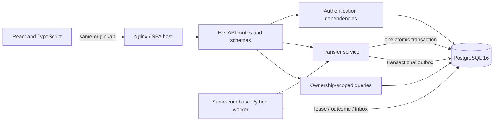

Nginx serves the production web build and proxies `/api`. In frontend development, Vite proxies API calls to port 8000. API documentation and health endpoints are available directly on port 8000.

| Boundary | Responsibility |
|---|---|
| [HTTP client](frontend/src/lib/api.ts) | Bearer attachment, response schemas, error parsing, timeout and coordinated refresh |
| [Authentication provider](frontend/src/auth.tsx) | Session boot, protected routes and cache clearing on logout/expiry |
| [Transfer UI](frontend/src/TransferForm.tsx) | Validation, review, one key per attempt, safe retry and query invalidation |
| [API routes](backend/app/main.py) | HTTP adaptation, dependencies, status codes, safe DTOs and logging |
| [Request/response schemas](backend/app/schemas.py) | Input boundaries and output contracts |
| [Repositories](backend/app/repositories.py) | Owned-account queries, visible transfers and database pagination |
| [Transfer service](backend/app/transfers.py) | Key claim, ownership/business checks, locks, movement, ledger and saved result |
| [Initial migration](backend/migrations/versions/001_initial.py) | Original tables and paired-ledger constraints |
| [Incremental migrations](backend/migrations/versions) | 002 lifecycle/audit, 003 beneficiaries, 004 funding baseline, 005 schedules/outbox/inbox |
| [Scheduling](backend/app/scheduling.py) / [worker](backend/app/worker.py) | Local-clock policy, versioned plans, fenced claims, shared posting and inbox delivery |
| [Reporting](backend/app/reporting.py) | Consistent snapshot, exact totals, signed search cursors and CSV |

The service is deliberately synchronous and monolithic. Transaction boundaries remain visible in one place, and PostgreSQL coordinates concurrent requests across processes.

## Transfer correctness and idempotency

### One successful transfer, one commit

```mermaid
sequenceDiagram
    participant UI as Transfer form
    participant API as FastAPI
    participant DB as PostgreSQL
    UI->>API: POST transfer + bearer + original key
    API->>API: Validate and hash normalized input
    API->>DB: BEGIN; claim unique user/operation/key
    alt A committed result already exists
        DB-->>API: Saved hash, status and JSON body
        API-->>UI: Replay result or reject changed input
    else New request
        API->>DB: Lock both accounts in UUID order
        API->>API: Check ownership, accounts and balances
        API->>DB: Update balances; insert transfer and two entries
        API->>DB: Save exact result; COMMIT
        API-->>UI: 201 receipt
    end
```

The unique constraint covers `(user_id, operation, key)`. `INSERT ... ON CONFLICT DO NOTHING` waits for a conflicting transaction; a subsequent statement at PostgreSQL READ COMMITTED isolation reads its committed result. Account locks follow one global UUID order for both transfer directions.

For a new valid transfer, the service checks source ownership and available funds before modifying balances. Debit, credit, transfer, ledger, audit, outbox events and saved response commit together. Scheduled execution also commits its occurrence outcome and next slot in that same transaction. A worker crash or unexpected write failure rolls back the entire transaction, including the uncommitted key claim.

| Request condition | Outcome |
|---|---|
| New key, valid input | One transfer; two ledger entries; saved `201` response |
| Same user/operation/key and same normalized input | Exact saved status/body; no additional movement |
| Same key with changed input | `409 IDEMPOTENCY_KEY_REUSED` |
| Insufficient funds | `409 INSUFFICIENT_FUNDS`; completed rejection stored; no transfer |
| Retry a saved insufficient-funds request after receiving funds | Original rejection replays; the old attempt cannot execute later |
| Unexpected failure before commit | All financial writes and the claim roll back; same-key retry can execute safely |
| Connection fails after the server may have committed | UI freezes the original attempt and offers explicit same-key retry |

Idempotency applies to the scoped operation/key, not to two deliberate transfers created with different keys. A new transfer after completion receives a new key. Auth-expiry recovery reuses the original request headers/body; an uncertain network/5xx outcome does not silently generate a replacement key.

## Data model and monetary rules

| Table | Responsibility | Important rules |
|---|---|---|
| `users` | Synthetic identity | Unique lowercase email; password hash; active flag |
| `accounts` | Owned materialized balance | Owner FK; unique fictional number; VND only; nonnegative safe integer |
| `transfers` | Committed movement | Distinct source/destination; positive amount; unique reference; immutable rows |
| `ledger_entries` | Movement audit trail | One debit and one credit; matching account/amount; immutable rows |
| `idempotency_records` | Request fingerprint and result | Scoped unique key; canonical hash; JSONB response; completion state |
| `refresh_sessions` | Rotating credential family | Unique token hash; user/family indexes; expiry, rotation and revocation timestamps |
| `audit_events` | Append-only action trail | Actor, target, action, safe metadata, request ID; immutable trigger |
| `beneficiaries` | Owner address book | One active destination per owner; archive preserves history |
| `transfer_schedules` / `schedule_occurrences` | Plans and execution facts | Version, due time, stable occurrence ID, lease token, capped attempts, linked committed transfer |
| `outbox_events` / `notifications` | Durable in-app delivery | Event written with posting; unique event ID deduplicates inbox; read timestamps |

All identifiers are server-generated UUIDs. Persisted event timestamps use UTC; schedule `starts_local` deliberately stores naive wall time alongside an IANA timezone. Histories sort by `created_at DESC, id DESC` and use account/date indexes. The seed uses deterministic fictional account IDs for an easy walkthrough.

Monetary values use integer VND throughout. Transfer amounts are limited to `1..9,007,199,254,740,991`, the common JSON-safe integer range. Booleans, fractional amounts, amount strings, zero and negative values are rejected at the HTTP boundary. The browser formats numbers for display and sends validated integer JSON. New statement aggregate amounts use canonical decimal strings and BigInt on the browser because turnover may exceed safe Number precision. V1 summary explicitly rejects an unsafe aggregate instead of rounding it.

A deferred PostgreSQL trigger requires every new transfer to have exactly two matching ledger entries at commit. Additional triggers validate ledger inserts and reject UPDATE/DELETE of committed transfer and ledger rows. Database owners remain privileged; the local demo does not claim protection against an administrator bypassing database controls.

Synthetic initial funding is established by seed rather than fictitious transfer entries. Migration 004 backfills an immutable opening baseline, allowing exact reconciliation against subsequent ledger entries. See [database design](docs/database-schema.md) for constraints, indexes, archival considerations and seed behavior.

## Authentication and security

| Concern | Implemented behavior |
|---|---|
| Password verification | Argon2id hashing; generic incorrect-credential errors |
| Access tokens | HS256 allowlist; required issuer, audience, expiry, issued-at, subject and JTI; 15-minute default lifetime |
| Browser token storage | Access token stays in application memory; no localStorage/sessionStorage persistence |
| Refresh credentials | High-entropy opaque token in an HttpOnly, SameSite=Strict, auth-path cookie; only SHA-256 hash stored |
| Rotation/reuse | Every refresh rotates the token; reuse revokes the family; PostgreSQL advisory/row locks serialize family operations |
| Logout | Revoke refresh family and clear cookie; issued bearer tokens expire naturally |
| Cookie request protection | Exact Origin allowlist on login, refresh and logout, plus explicit credentialed CORS configuration |
| Object access | Accounts, recipients, plans, statements and inbox scoped to owner; receipt visible to involved owner |
| Roles | CUSTOMER posts money; OPERATIONS freezes with reason; AUDITOR/OPERATIONS read immutable audit; worker revalidates active customer |
| Recipient throttling | 30 authenticated recipient lookups per user/minute per API process |
| Error/log hygiene | Sanitized error envelope and generated request ID; no submitted passwords, bearer headers or refresh cookies in request logs |
| Sign-in throttling | Ten attempts per source IP per 60 seconds within one API process |
| Local exposure | Loopback-only published ports; development HTTP cookie settings |
| Browser responses | CSP, frame-ancestor restriction, content-type and referrer headers in Nginx |

Refresh tokens default to seven days per issued token. Rotation issues a new token with a new expiry. Session restoration and concurrent API refresh calls are coordinated within one browser tab.

CLI clients must include an allowed `Origin` for cookie-authentication endpoints. Account/transfer requests require bearer tokens. Missing or invisible objects return `404` where appropriate, and counterparty profiles/emails are not returned with receipts.

Public credentials and `.env.example` values are local demonstration settings. Public hosting would require TLS, managed secrets, Secure cookies, restricted origins, separate database roles and deployment-wide rate limiting. The full [security model](docs/security.md) records assumptions, tests and remaining limits.

## API reference and replay exercise

The API uses the `/api/v1` prefix. The table below preserves V1; [V2 API contracts](docs/v2/API_CONTRACTS.md) list all additive endpoints and state/version rules. [Swagger UI](http://localhost:8000/docs) and [OpenAPI JSON](http://localhost:8000/openapi.json) describe request/response schemas when the local stack is running.

| Method | Path | Success | Access |
|---|---|---|---|
| POST | `/auth/login` | `200` access token + refresh cookie | Credentials + allowed Origin |
| POST | `/auth/refresh` | `200` rotated tokens | Refresh cookie + allowed Origin |
| POST | `/auth/logout` | `204` | Refresh cookie + allowed Origin |
| GET | `/auth/me` | `200` safe profile | Bearer |
| GET | `/accounts` | `200` owned account array | Bearer |
| GET | `/accounts/{id}` | `200` owned account | Bearer |
| POST | `/transfers` | `201` committed receipt | Bearer + `Idempotency-Key` |
| GET | `/transfers` | `200` paginated history | Bearer |
| GET | `/transfers/{id}` | `200` visible receipt | Bearer |
| GET | `/dashboard/summary` | `200` balances/counts/recent transfers | Bearer |

Transfer-list filters: `page`, `page_size` (1–50), owned `account_id`, `direction=INCOMING|OUTGOING` and `reference`. The web UI requests ten rows per history page; the API defaults to twenty. Pagination returns `{items,page,page_size,total,total_pages}`.

### Transfer request

```http
POST /api/v1/transfers
Authorization: Bearer <access-token>
Idempotency-Key: 550e8400-e29b-41d4-a716-446655440000
Content-Type: application/json
```

```json
{
  "source_account_id": "00000000-0000-4000-8000-000000000001",
  "destination_account_id": "00000000-0000-4000-8000-000000000002",
  "amount_vnd": 150000,
  "memo": "Portfolio walkthrough"
}
```

Keys contain 8–100 ASCII letters, digits, underscores or hyphens. Successful replays keep the saved JSON/status and return `X-Idempotency-Replayed: true`. References and timestamps are generated by the server.

### Error contract

```json
{
  "error": {
    "code": "INSUFFICIENT_FUNDS",
    "message": "The source account has insufficient funds.",
    "details": {},
    "request_id": "generated-request-uuid"
  }
}
```

| HTTP status | Typical meaning |
|---|---|
| `401` | Missing/invalid/expired access, bad credentials or rejected refresh |
| `403` | Disallowed Origin or role |
| `404` | Missing or unauthorized account/transfer |
| `409` | Funds/status/limit conflict, changed idempotent input, stale schedule version or invalid lifecycle action |
| `422` | Malformed request, invalid amount, missing key or self-transfer |
| `429` | Sign-in attempt limit |
| `500` / `503` | Sanitized unexpected failure / service readiness failure |

Validation details contain field paths and messages without submitted input values. `X-Request-ID` identifies the current HTTP request; a replayed business-error body retains the original saved request ID. The [full contract](docs/api-contract.md) lists exact codes.

<details>
<summary><strong>Run an API-level same-key replay check</strong></summary>

Run from the repository root after startup. This exercise uses Python's standard library inside the backend container; no host Python or additional package is needed. It moves **1 fictional VND**, replays the original request and confirms that changing the amount with the same key is rejected. Existing balances are preserved apart from that one transfer.

```bash
docker compose exec -T backend python - <<'PY'
import json
import uuid
from urllib.error import HTTPError
from urllib.request import Request, urlopen

BASE = "http://localhost:8000/api/v1"

def post(path, payload, headers=None):
    request = Request(
        BASE + path,
        data=json.dumps(payload).encode(),
        headers={"Content-Type": "application/json", **(headers or {})},
        method="POST",
    )
    try:
        with urlopen(request, timeout=15) as response:
            return response.status, json.load(response), dict(response.headers)
    except HTTPError as error:
        return error.code, json.load(error), dict(error.headers)

status, login, _ = post(
    "/auth/login",
    {"email": "alice@example.test", "password": "DemoPass123!"},
    {"Origin": "http://localhost:5173"},
)
assert status == 200, login
headers = {
    "Authorization": "Bearer " + login["access_token"],
    "Idempotency-Key": str(uuid.uuid4()),
}
payload = {
    "source_account_id": "00000000-0000-4000-8000-000000000001",
    "destination_account_id": "00000000-0000-4000-8000-000000000002",
    "amount_vnd": 1,
    "memo": "README replay exercise",
}
first = post("/transfers", payload, headers)
replay = post("/transfers", payload, headers)
conflict = post("/transfers", {**payload, "amount_vnd": 2}, headers)
assert first[0] == replay[0] == 201, (first[1], replay[1])
assert first[1] == replay[1]
assert {key.lower(): value for key, value in replay[2].items()}["x-idempotency-replayed"] == "true"
assert conflict[0] == 409
assert conflict[1]["error"]["code"] == "IDEMPOTENCY_KEY_REUSED"
print("PASS: one transfer, exact replay, changed-input conflict; reference:", first[1]["reference"])
PY
```

For direct proof of row counts and balanced entries, run `make test-backend`; the replay and concurrent-request cases assert the database invariants, not only HTTP equality.

</details>

## Testing and verification

### Run the complete local check sequence

After creating `.env`, install the frontend test dependencies and Chromium:

```bash
cd frontend
npm ci
npx playwright install chromium
cd ..
make ci
```

On a Linux host that needs browser system packages, use `npx playwright install --with-deps chromium` from `frontend` instead. GitHub Actions includes this step.

`make ci` builds/starts the app, runs frontend tests, lint/type checking, backend tests with coverage, language parity and the isolated Compose/E2E stack. Local Python installation is optional because Make uses the backend image.

### Latest V2 verification

| Check | Observed result | Scope |
|---|---|---|
| Backend | **134 passed**, 95% application line coverage | PostgreSQL/API, migrations, process recovery, worker, statements and security |
| Frontend | **70 passed** in eight files | Vitest component/client/contract and parity checks |
| Browser | **10 passed** | Real API, PostgreSQL and worker journeys, CSV download and responsive bounds |
| Migration parity | **36 matched** in baseline and incremental runs | Exact Python/TypeScript canonical fixture comparison |
| Build/quality | Local commands recorded with results | Production build, Ruff, ESLint, Prettier, strict TypeScript |
| GitHub Actions | **Defined; remote run pending** | No successful remote workflow run claimed |
| Native Linux amd64 | **Not executed locally** | Configured for GitHub-hosted runner |

Baseline and each verified V2 slice are recorded in [TEST_REPORT.md](docs/v2/TEST_REPORT.md), including failures found and fixed. Local suite results do not establish production availability or throughput.

Both language-specific test counts include the same 36 fixture cases. The standalone comparison is a separate parity check, not 36 extra UI journeys.

### Concurrency and failure evidence

| Scenario | What the test requires |
|---|---|
| 24 simultaneous same-key requests | All responses point to one committed transfer; one debit/credit effect |
| 12 distinct-key requests spending 1,000,000 VND each | Five successes, seven insufficient-funds conflicts; no negative balance |
| 16 opposite-direction transfers | Complete without deadlock in the tested interleaving; original balances preserved |
| Exception during ledger insertion | No changed balance, transfer, ledger entry or stuck key claim; retry succeeds |
| Insufficient-funds replay after funding | Original rejection remains stable |
| Rotated refresh cookie reused | Whole family revoked; newly issued refresh token rejected |
| Two concurrent refreshes using one old token | One success, one reuse rejection, family revocation |
| Bob requests an existing Alice/Carol transfer | `404`; unrelated history stays empty |
| Ledger UPDATE/DELETE or incomplete transfer | Database rejects mutation or unbalanced commit |
| Forced process exit before/after posting commit | Precommit writes roll back; committed exact result replays |
| Multiple worker processes / expired lease | One money effect; stale lease token cannot post |
| Worker death during posting / inbox acknowledgment | Atomic rollback or committed outcome; lease recovery and event dedupe |
| Concurrent statement read and transfer commit | Snapshot remains internally reconciled |
| Seeded V1 upgrade / disposable backup restore | Existing balances and posting counts preserved |

Concurrency tests synchronize independent request threads and spawned processes with barriers and execute real PostgreSQL transactions. They do not replace row locks with mocks or use SQLite as a concurrency substitute. These are correctness tests, not throughput or production load benchmarks.

### Individual commands

Run from the repository root after `make up` and frontend dependency installation:

| Command | Purpose |
|---|---|
| `make test-backend` | Create guarded test DB if needed; Pytest with coverage |
| `make test-frontend` | `npm ci` and Vitest |
| `make parity` | Compare Python/TypeScript canonical results |
| `make lint` | Ruff lint/format, ESLint, Prettier and TypeScript |
| `make test-e2e` | Build/start a fresh disposable stack; run Playwright; clean up |
| `npm --prefix frontend run build` | Type checking and production web build |
| `npm --prefix frontend run format` | Apply frontend formatting |
| `CAPTURE_V2=1 make test-e2e` | Regenerate actual V2 recipients, receipt, statement, schedule and inbox captures |
| `CAPTURE_DEMO=1 make test-e2e` | Regenerate dashboard, login, review, receipt and mobile screenshots from a real run |

### Test isolation and reports

Backend tests use `banking_test` and refuse a database name without the `_test` suffix before truncating test tables. Browser tests use the separate `moneta-e2e` Compose project and `banking_e2e_test` database, with ports **5174**, **8001** and **5434**. The E2E script recreates and removes that named test project's volume; it preserves the interactive demo volume.

Playwright writes a report under `frontend/playwright-report`; failed tests retain traces/screenshots. Failed E2E runs also save stack logs under `frontend/test-results/stack.log`. View the browser report with:

```bash
cd frontend
npx playwright show-report
```

Generated reports and local environment files are ignored by Git. [Testing notes](docs/testing-and-ci.md) explain the lifecycle and evidence in more detail.

## GitHub Actions

The [CI workflow](.github/workflows/ci.yml) runs on pushes to `main`, pull requests and manual dispatch. It has read-only repository permissions and cancels outdated runs for the same ref.

| Job | Checks |
|---|---|
| `quality` | PostgreSQL 16 service; Python 3.12; Node 22; Ruff; backend tests/coverage; frontend install/lint/build/tests; Python/TypeScript parity |
| `compose-and-e2e` | Compose configuration; Chromium/system dependencies; container builds; readiness/startup and the current real-stack browser suite, including worker delivery |

On failure, Actions uploads available backend reports or Playwright reports/traces and stack logs. There is no deployment job.

The workflow has been defined and its YAML parsed locally. **Remote GitHub Actions execution remains unverified until the repository is pushed and a real run completes.** No green CI badge is used to imply a result that has not happened.

## Configuration and development

### Root `.env`

Start from [.env.example](.env.example). These variables are passed by Compose:

| Variable | Local default / purpose |
|---|---|
| `POSTGRES_USER` | `banking` — local database role |
| `POSTGRES_PASSWORD` | `local-demo-database-only` — public local example value |
| `POSTGRES_DB` | `banking` — interactive demo database |
| `JWT_SECRET` | Local example signing secret; API requires at least 32 characters |
| `COOKIE_SECURE` | `false` for local HTTP; use Secure cookies with an HTTPS deployment |
| `ALLOWED_ORIGINS` | `http://localhost:5173,http://127.0.0.1:5173` — exact comma-separated origins |

Keep the defaults for the first local walkthrough. Access-token TTL, refresh lifetime and docs visibility are API settings in [config.py](backend/app/config.py); changing them in containers requires adding the corresponding backend environment entries to Compose. They are not automatically forwarded merely by adding new root `.env` keys.

### Frontend hot reload

Run API/database in Docker and Vite on the host:

```bash
# From the repository root, with .env already created.
docker compose stop frontend
docker compose up -d --build db backend worker
cd frontend
npm ci
npm run dev
```

Vite serves port 5173 and proxies `/api` to localhost:8000. Stop any other process using 5173 so Vite can use the configured origin. Frontend edits hot-reload; the containerized production frontend requires a rebuild.

### Backup and upgrade rehearsal

```bash
./scripts/backup-demo.sh /absolute/private/path/moneta.dump
./scripts/restore-demo-check.sh /absolute/private/path/moneta.dump
```

Backup refuses overwrite and uses private permissions. Restore check creates its own disposable `restore_*_test` database, migrates it and verifies unchanged balances/posting counts plus baseline reconciliation. It preserves the interactive database. An actual V1-to-current rehearsal was run; see [deployment checklist](docs/v2/DEPLOYMENT_CHECKLIST.md). This is local recovery evidence, not production disaster recovery.

### Operational commands

```bash
docker compose ps
docker compose logs --tail=100 backend worker
docker compose logs --tail=100 frontend
make migrate
make seed
make up
```

Migrations and seeding also run automatically at backend startup. `make up` rebuilds changed images. No balance-edit or seed-reset HTTP endpoint is exposed.

<details>
<summary><strong>Reset the local demo database to its starting balances</strong></summary>

The following commands delete this Compose project's local database volume, including all simulated transfers and sessions. Run them only when you intend to discard that local demo data.

```bash
docker compose down --volumes
docker compose up --build -d --wait
```

A fresh volume recreates Alice and Bob at their original balances. For repeatable automated demonstrations without resetting your interactive database, use `make test-e2e`.

</details>

## Troubleshooting

| Symptom | Check / resolution |
|---|---|
| `Cannot connect to the Docker daemon` | Start Docker Desktop or the Docker daemon, then rerun the startup command. |
| Compose reports a missing `JWT_SECRET` | Run `cp .env.example .env` from the repository root before startup. |
| Compose cannot parse `!override` | Upgrade Compose to 2.24.4+; the tag is used in the E2E override file. |
| Port already allocated | Check 5173/8000/5433 for the demo and 5174/8001/5434 for E2E. Stop the conflicting local process. |
| Vite starts on 5174 | Stop the container frontend or other process using 5173, then restart Vite; the standard API origin allowlist expects 5173. |
| API is not ready | Inspect `docker compose logs --tail=100 backend` and `docker compose ps`; check database health and migration startup. |
| `403 ORIGIN_REJECTED` | Open the configured localhost URL or send an exact allowed Origin header from the CLI. Include the scheme and port. |
| `429 RATE_LIMITED` | Wait for the 60-second sign-in window. The local process tracks requests by its observed source IP; proxied clients can share that limit. |
| Balances differ from the walkthrough | Earlier transfers are persisted. Re-seeding does not undo them; use a fresh E2E stack or the explicit reset procedure. |
| Dropdowns still look like native OS menus | Rebuild the frontend with `docker compose up -d --build --no-deps frontend`, then reload the page. |
| Browser test executable missing | Run `npx playwright install chromium` inside `frontend`; Linux may also need `--with-deps`. |
| `DATABASE_URL must target a disposable database ending in _test` | Use `make test-backend`; do not point destructive test fixtures at the interactive database. |
| Schedule remains pending | Confirm worker is running; inspect `docker compose logs --tail=100 worker`. Check due timezone, status, retry time and sanitized occurrence error. No funds are reserved. |
| Different tabs unexpectedly require sign-in again | Per-tab refresh coordination cannot prevent simultaneous rotation in separate tabs; family reuse detection can require a fresh login. |
| Transfer outcome is unknown after a network error | Use **Retry original transfer**. If the page was reloaded and the draft is lost, inspect history before creating a new attempt. |

## Repository map and engineering notes

```text
fullstack-banking-platform/
├── README.md
├── Makefile
├── .env.example
├── docker-compose.yml
├── docker-compose.e2e.yml
├── .github/workflows/ci.yml
├── backend/
│   ├── app/                   # Routes, schemas, auth, repositories and transfer service
│   ├── migrations/            # Alembic DDL, indexes and ledger triggers
│   ├── tests/                 # API, concurrency, rollback and shared fixtures
│   ├── pyproject.toml
│   └── Dockerfile
├── frontend/
│   ├── src/
│   │   ├── components/        # Shell, reusable UI and accessible dropdown
│   │   ├── lib/               # Typed HTTP boundary and display formatting
│   │   └── test/              # Component, client, auth and parity tests
│   ├── e2e/                   # Playwright journeys
│   ├── package-lock.json
│   └── Dockerfile
├── migration/
│   ├── python/
│   ├── typescript/
│   └── shared-test-cases/
├── challenges/                # Isolated debugging explanations
├── scripts/                   # Test DB creation, parity and isolated E2E lifecycle
└── docs/                      # Design notes, screenshots and verification report
```

| Document | What it explains |
|---|---|
| [V2 delivery status](docs/v2/IMPLEMENTATION_STATUS.md) | Current increment, checks, explicit gaps and next executable step |
| [V2 architecture and APIs](docs/v2/ARCHITECTURE.md) | Worker, domain boundaries, transaction sequence and links to current contracts |
| [Architecture — V1 baseline](docs/architecture.md) | Module boundaries, transaction flow and cache/session state |
| [Database design](docs/database-schema.md) | Schema, invariants, seed identities and retention decisions |
| [Security model](docs/security.md) | Threats, implemented controls, evidence and assumptions |
| [API contract](docs/api-contract.md) | Endpoints, payloads, pagination, exact error codes and replay semantics |
| [Migration parity](docs/migration-parity.md) | Python bool/int, JavaScript safe integers, Unicode length and canonical results |
| [Debugging case study](docs/debugging-case-study.md) | Duplicate processing across browser/API/DB and an actual `.test` email-validation integration issue |
| [Testing and CI](docs/testing-and-ci.md) | Reproducible checks, database isolation, reports and workflow |
| [Tradeoffs](docs/tradeoffs.md) | Deliberate simplifications and conditions for changing them |
| [Demo script](docs/demo-script.md) | Seven-minute interviewer walkthrough |
| [Implementation report](docs/implementation-report.md) | Observed commands, results and checks not executed |

The debugging challenges remain separate from shipping application behavior:

- [Duplicate transactions and race conditions](challenges/duplicate-transactions/README.md)
- [Authentication and object authorization](challenges/authentication/README.md)
- [API contract mismatch](challenges/api-contract-debugging/README.md)

No intentionally broken code is imported into the running app. The pure migration functions also remain independent of database/network/time behavior.

## Scope, tradeoffs and next steps

| Current boundary | Reason / next step |
|---|---|
| Synchronous modular API plus one same-codebase worker | PostgreSQL owns money and queue coordination; revisit topology only with measured need. |
| Materialized balances plus immutable movement ledger | Fast reads and transactional audit entries. Immutable funding baseline supports exact statements; persisted operational reconciliation findings/UI remain pending. |
| Indefinite idempotency retention | Avoids premature duplicate execution. A production archival policy must preserve retry guarantees. |
| In-memory transfer recovery draft | Preserves safe retries within the current page. Cross-reload recovery needs a deliberate persistence/reconciliation design. |
| Per-tab refresh coordination | Prevents refresh storms within a tab. Cross-tab coordination remains a future improvement. |
| Access-token expiry after logout | Refresh family is revoked immediately; bearer access can remain valid for up to its 15-minute default lifetime. |
| Process-local sign-in limit and shared local DB role | Appropriate for a reproducible demo. Public deployment needs shared limits, trusted proxy configuration and least-privilege roles. |
| Backend image includes test tooling | Reviewers can run checks without host Python. A deployment image should contain runtime dependencies only. |
| Chromium automation and native ARM64 local execution | These environments were exercised. Other browsers, remote Linux CI and public hosting require their own validation. |

**Pending V2:** dashboard trends/categories/budgets (M6), notification preferences and password/session settings (M7), operations jobs/incident UI/metrics (M8), optional P2 features and full release hardening. The working inbox and account-control screen do not imply those milestones are complete. See [feature matrix](docs/v2/FEATURE_MATRIX.md).

No real payment rails, registration, KYC, MFA, password reset, SMS/email delivery, regulatory certification or production deployment are included. The simulation is intended to make application behavior and engineering decisions reviewable.

## Publishing this portfolio

<details>
<summary><strong>Maintainer setup: personal GitHub identity, first push and presentation</strong></summary>

Create an empty personal GitHub repository named `fullstack-banking-platform`. Check the Git identity before the first commit:

```bash
git config user.name
git config user.email
```

If the current values belong to another identity, set repository-local values using your GitHub name and your verified email or GitHub-provided private commit email:

```bash
git config --local user.name "YOUR_NAME"
git config --local user.email "YOUR_GITHUB_COMMIT_EMAIL"
```

Replace `YOUR_USERNAME` in the remote URL below. These initial-commit instructions assume the repository has no commit and no `origin` yet:

```bash
git add .
git commit -m "Build Moneta full-stack banking simulation"
git remote add origin https://github.com/YOUR_USERNAME/fullstack-banking-platform.git
git push -u origin main
```

If `origin` already exists, inspect `git remote -v` and use your intended repository URL rather than adding a duplicate remote. After pushing, inspect the actual **Actions** run. Add a CI status badge only after a real successful run exists.

Suggested GitHub description:

> React + FastAPI + PostgreSQL banking simulation with atomic transfers, scheduled payments, a durable worker, reconciled CSV statements and real-process recovery tests.

Suggested topics: `fullstack`, `react`, `typescript`, `fastapi`, `postgresql`, `docker`, `github-actions`, `playwright`, `idempotency`.

For a job application, link the repository and describe one decision you can demonstrate: ordered row locking, exact-response replay, refresh-family revocation or cross-language integer behavior. The [demo script](docs/demo-script.md) provides a review sequence. Explain the implementation and tooling honestly; local portfolio results do not imply production banking experience.

</details>
