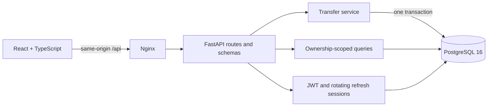

# Architecture

Moneta is one React web app, one synchronous FastAPI service and one PostgreSQL 16 database. No commercial APIs or banking connections.

## Boundaries

- `frontend/src/lib/api.ts`: runtime Zod response contracts, memory-only bearer token, one coordinated refresh, bounded network timeout and typed errors.
- `frontend/src/TransferForm.tsx`: form state, explicit review, one request key per attempt, frozen unknown-outcome retry.
- `backend/app/main.py`: HTTP adaptation, dependency injection, error envelopes, health and request logs.
- `schemas.py`: request validation and safe response fields.
- `security.py`: password verification, access tokens, cookie sessions, family rotation and revocation.
- `repositories.py`: ownership-scoped reads and database pagination.
- `transfers.py`: transaction boundaries, unique-key claim, locks, invariant checks, debit/credit, ledger and response persistence.
- Alembic migration: frozen schema DDL, indexes, CHECK/FK/unique constraints and ledger triggers.

## Transfer transaction

1. Validate request and key. Hash canonical validated JSON including authenticated owner.
2. Insert key claim with `ON CONFLICT DO NOTHING`. A conflicting insert waits for the competing transaction.
3. Read and lock the key row. At PostgreSQL READ COMMITTED isolation, this new statement sees the committed result. Reject changed input or replay the stored response.
4. Lock both accounts with `ORDER BY id FOR UPDATE`. Check ownership, recipient, currency, amount and balance.
5. Update balances, insert transfer, insert debit and credit, save exact response. Commit once.
6. Return only after commit. Any unexpected error rolls everything back, including the key claim.

Business rejections commit a completed error record without a transfer. A retry of insufficient funds therefore stays rejected even after the account receives funds. Retrying an unknown outcome uses the original key, never a fresh key.

## State and caching

TanStack Query owns remote state. Successful transfers invalidate account, dashboard and history queries. React Router protects all workspace pages. Auth boot restores from an HttpOnly refresh cookie before route decisions. No token is persisted in browser storage. Queries are cleared on logout or session expiry.

## Operations

Compose waits for PostgreSQL health, then API migration/readiness, then frontend. API startup applies Alembic and idempotently seeds two demo users. Nginx serves the SPA and proxies `/api`. Local ports bind only to loopback. E2E uses a separate Compose project, database, ports and disposable volume.
