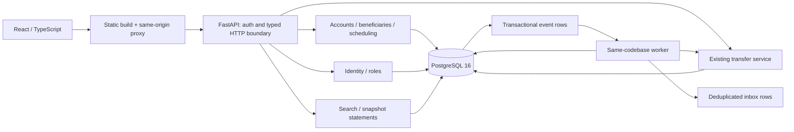

# V2 architecture

Current increment: M0–M5. See [status](IMPLEMENTATION_STATUS.md) for verification and unimplemented scope. This is a local fictional banking simulation.



This is one modular monolith plus one worker, not independent network services. Existing file names and V1 routes remain stable. `app/main.py`, `v2.py`, `schedule_api.py` and `inbox_api.py` adapt HTTP. Domain modules own transaction rules; `repositories.py` scopes reads. SQLAlchemy is synchronous because explicit short transactions and visible row locking suit this workload. No network delivery runs inside a money transaction.

| Module | Durable responsibility | Important boundary |
|---|---|---|
| security | Users, rotating refresh families | In-memory access token; server-side role/activity |
| accounts | Lifecycle, limits, immutable audit | Same account lock as posting; no balance setter |
| transfers | Idempotency, posting, paired ledger, event creation | Exactly one committed effect per scoped key |
| beneficiaries | Private recipient address book | Archived records preserve history |
| reporting | Search and reconciled CSV | Owner scope, repeatable snapshot, decimal aggregates |
| scheduling | Plan and next occurrence | Creation reserves no money; versioned future edits |
| worker | Lease, execution, retry, inbox delivery | Fenced lease; shared transfer service; bounded attempts |

```mermaid
sequenceDiagram
  participant W as Worker
  participant DB as PostgreSQL
  participant T as Transfer service
  W->>DB: Claim due occurrence SKIP LOCKED; save lease token; COMMIT
  W->>DB: BEGIN; lock schedule then occurrence; verify token/status
  W->>T: Execute original occurrence key in same transaction
  T->>DB: Claim/replay key; lock accounts in UUID order
  T->>DB: Validate; post balanced ledger; save result and outbox
  W->>DB: Record occurrence; next slot; audit and outcome event
  W->>DB: COMMIT money + outcome atomically
  W->>DB: Claim outbox in later transaction
  W->>DB: Insert inbox ON CONFLICT; mark delivered; COMMIT
```

READ COMMITTED posting relies on unique idempotency claim and ordered account row locks. Statement reads use REPEATABLE READ to avoid mixed snapshots. Lifecycle and schedule creation share account locks; actions/execution share schedule locks. Queue SKIP LOCKED is used only for jobs, never to skip a balance lock.

Migrations 002–005 are additive; 004 backfills historical funding. Financial facts/audit/baseline have immutable triggers. Local runtime uses one database role, so database-owner bypass is outside the guarantee. Reporting and inbox reads are bounded; schedules list latest 200 and execution history latest 50. Large-scale retention, metrics aggregation and separate runtime/migrator privileges are future work.

Frontend uses TanStack Query for server state and local React state for drafts. Committed balances never update optimistically. Unknown transfer outcomes retain the original payload/key within the page. Query schemas validate all consumed responses. New schedule and inbox screens consume real APIs; no random chart or notification data is generated.

Decisions: [posting](ADR/001-incremental-upgrade.md), [statements](ADR/002-statement-snapshots.md), [scheduling](ADR/003-scheduled-posting-and-delivery.md).
